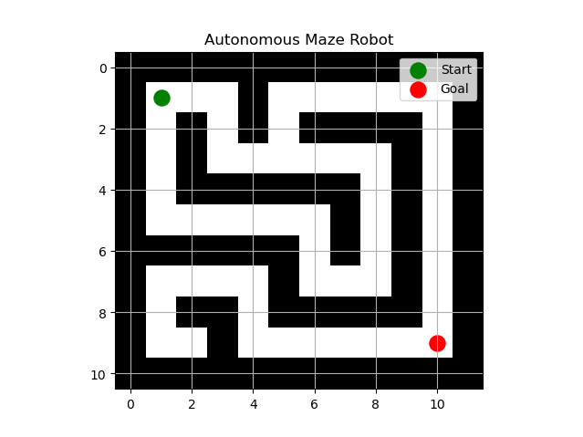
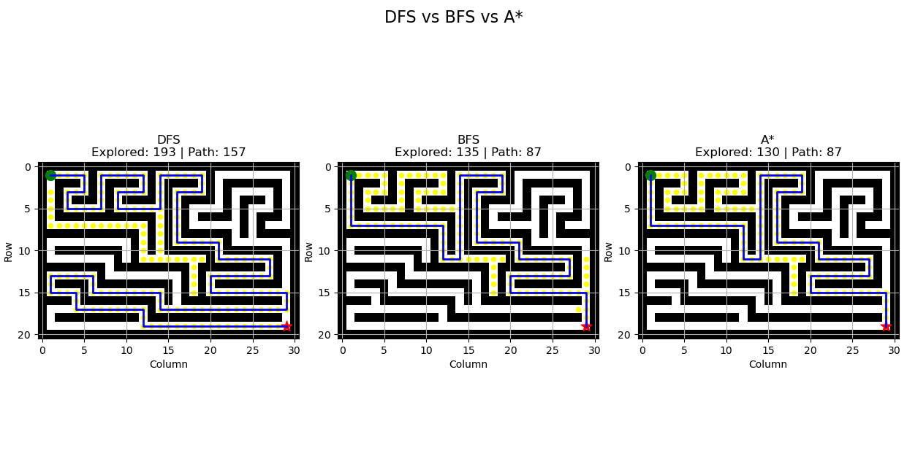
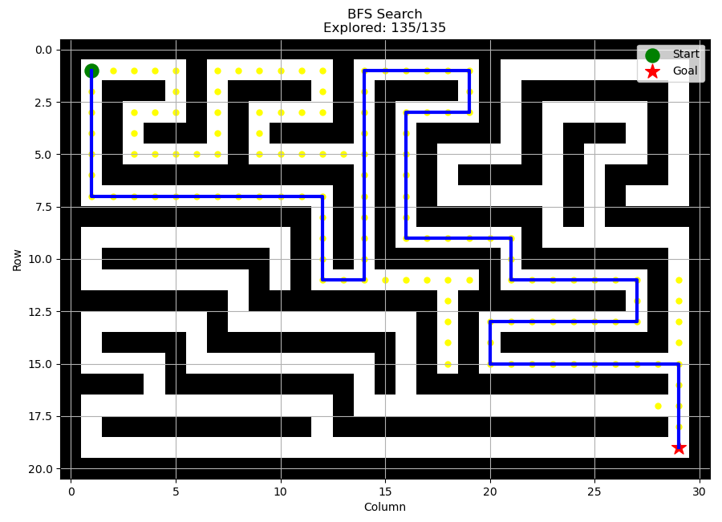

# 🤖 Autonomous Maze Solver Simulation using Python

<p align="center">
  <strong>An intelligent maze-solving simulation using classical pathfinding and search algorithms.</strong>
</p>

<p align="center">
  
</p>

<p align="center">
  
  
  
  
</p>

## 📌 Overview

The **Autonomous Maze Solver** is a Python-based simulation project that demonstrates how an autonomous agent can navigate through a maze using different search and pathfinding algorithms.

The project implements A* (A-Star), Breadth-First Search (BFS), and Depth-First Search (DFS) to explore maze environments, identify valid paths, and reach a predefined goal while avoiding obstacles.

It also provides animated search visualization and performance comparisons to understand how different algorithms behave during autonomous navigation.

## ✨ Key Features

- **Multiple Search Algorithms:** Implementation of A*, BFS, and DFS.
- **Maze Environment:** Grid-based maze with walls and traversable paths.
- **Path Planning:** Finds a route from the starting position to the goal.
- **Animated Visualization:** Displays the search process and explored cells.
- **Algorithm Comparison:** Compares search behavior and path lengths.
- **Performance Analysis:** Measures algorithm execution time and exploration results.
- **Obstacle Avoidance:** Prevents movement through walls and invalid cells.

## 🧠 Algorithms Implemented

### 1. A* (A-Star) Algorithm

A heuristic-based search algorithm that combines the actual path cost and estimated distance to the goal.

Evaluation function:

`f(n) = g(n) + h(n)`

- `g(n)` – Cost from the starting node.
- `h(n)` – Estimated cost to the goal.
- `f(n)` – Total estimated path cost.

### 2. Breadth-First Search (BFS)

Explores neighboring cells level by level using a FIFO queue.

- Finds a shortest path when all movements have equal cost.
- Systematically explores reachable cells.
- Useful for unweighted maze environments.

### 3. Depth-First Search (DFS)

Explores one path as deeply as possible before backtracking, using a stack.

- Explores paths deeply.
- Uses a stack-based search strategy.
- Does not guarantee the shortest path.

## 📊 Algorithm Comparison

The following visualization compares the explored cells and final paths generated by DFS, BFS, and A*.

<p align="center">
  
</p>

| Algorithm | Search Strategy | Shortest Path Guarantee |
|---|---|---|
| DFS | Depth-based | No |
| BFS | Level-based | Yes, for equal-cost movements |
| A* | Heuristic-based | Yes, with an admissible heuristic |

## 🎬 Search Visualization

The project includes animated visualization of the algorithms, showing how the search progresses through the maze.

<p align="center">
  
</p>

**Visualization legend:**
- 🟢 Green: Starting position
- ⭐ Red: Goal position
- 🟡 Yellow: Explored cells
- 🔵 Blue: Final path
- ⬛ Black: Obstacles / walls

## 🛠️ Technologies Used

| Technology | Purpose |
|---|---|
| Python | Core programming |
| NumPy | Maze grid representation |
| Matplotlib | Maze visualization |
| Matplotlib Animation | Animated search visualization |
| Heapq | Priority queue for A* |
| Collections Deque | Queue implementation for BFS |

## 📁 Project Structure

```text
autonomous_maze_robot/
│
├── algorithms/
│   ├── astar.py
│   ├── bfs.py
│   └── dfs.py
│
├── visualization/
│   ├── maze_visualizer.py
│   └── animated_search.py
│
├── maze.py
├── comparison.py
├── comparison_old.py
├── test_maze_astar.py
│
├── Figure_1.png
├── Figure_2.png
├── Figure_3.png
│
└── README.md
```

## ⚙️ Installation and Setup

### Prerequisites

- Python 3.x
- pip package manager

### 1. Clone the Repository

```bash
git clone https://github.com/akash123suresh-cyber/Autonomous-_-maze-_-solver-_simulation-_using-_Python-.git
```

### 2. Navigate to the Project Directory

```bash
cd Autonomous-_-maze-_-solver-_simulation-_using-_Python-
```

### 3. Install Dependencies

```bash
pip install numpy matplotlib
```

## ▶️ Run the Simulation

Run the individual algorithms:

**A* Algorithm**
```bash
python algorithms/astar.py
```

**Breadth-First Search**
```bash
python algorithms/bfs.py
```

**Depth-First Search**
```bash
python algorithms/dfs.py
```

**Animated Search Visualization**
```bash
python visualization/animated_search.py
```

**Algorithm Comparison**
```bash
python comparison.py
```

A Matplotlib window will display the corresponding maze visualization or algorithm comparison.

## 🎯 Project Objectives

- Understand fundamental search and pathfinding algorithms.
- Explore autonomous navigation in a grid-based environment.
- Visualize how different algorithms explore a search space.
- Compare algorithm efficiency and pathfinding behavior.
- Develop a foundation for robotics navigation and autonomous decision-making.

## 🚀 Future Improvements

- Dynamic maze generation.
- Interactive start and goal selection.
- Real-time obstacle detection and avoidance.
- Comparison of additional pathfinding algorithms such as Dijkstra's algorithm.
- Integration with ROS 2 and Gazebo.
- Application to a physical autonomous mobile robot.

## 👨‍💻 Author

**Akash Suresh**

Robotics and Artificial Intelligence Engineering

GitHub: [@akash123suresh-cyber](https://github.com/akash123suresh-cyber)

---

<p align="center">
  <strong>Exploring Intelligent Navigation Through Search Algorithms 🚀</strong>
</p>